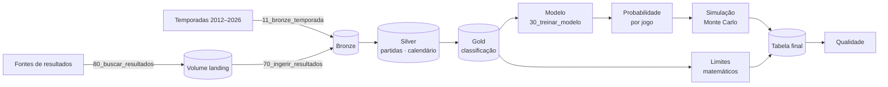
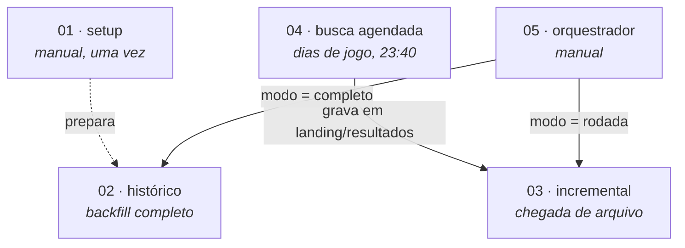

# Brasileirão 2026 · Probabilidades com Lakeflow Jobs

Estudo de probabilidades do **Brasileirão Série A 2026**: chances de título e de rebaixamento de cada clube, calculadas por um modelo de força dos times e por simulação Monte Carlo dos jogos restantes.

O projeto também é o **caso prático da aula de Databricks Lakeflow Jobs**: cada etapa do pipeline mostra um recurso de orquestração (tarefas encadeadas, *for each*, *condition task*, *task values*, gatilho por chegada de arquivo, agendamento, retries, alertas de duração e um job que chama outros jobs).

---

## Sumário

- [Visão geral](#visão-geral)
- [Estrutura do repositório](#estrutura-do-repositório)
- [Notebooks](#notebooks)
- [Jobs](#jobs)
- [Parâmetros](#parâmetros)
- [Como rodar (aula, só pela interface web)](#como-rodar-aula-só-pela-interface-web)
- [Deploy automático (CI/CD)](#deploy-automático-cicd)
- [Problemas comuns](#problemas-comuns)
- [Segurança](#segurança)

---

## Visão geral

O pipeline segue a arquitetura medalhão:



E é executado por cinco jobs:



---

## Estrutura do repositório

```
brasileirao/
├── databricks.yml                  # definição do bundle (Databricks Asset Bundles)
├── resources/
│   └── jobs/                       # um YAML por job
│       ├── brasileirao_01_setup.yml
│       ├── brasileirao_02_historico.yml
│       ├── brasileirao_03_incremental.yml
│       ├── brasileirao_04_busca_agendada.yml
│       └── brasileirao_05_orquestrador.yml
├── src/
│   ├── lib/
│   │   └── brasileirao/            # código compartilhado (config, parâmetros, task values)
│   └── notebooks/                  # notebooks executados pelos jobs
└── .github/
    └── workflows/
        └── deploy-databricks.yml   # CI/CD: valida em PR, faz deploy na main
```

Os notebooks importam o pacote compartilhado assim:

```python
sys.path.append(os.path.abspath("../lib"))
from brasileirao.config import Config, parametro, registrar_valor
```

---

## Notebooks

| Notebook | Camada | O que faz |
|---|---|---|
| `00_setup` | — | Cria schemas, volume e copia os arquivos de dados para o volume |
| `10_listar_temporadas` | — | Gera a lista de temporadas do backfill e publica como *task value* `temporadas` |
| `11_bronze_temporada` | Bronze | Carrega uma temporada (executado pelo *for each*, uma vez por temporada) |
| `20_silver_partidas` | Silver | Partidas tratadas; modo `full` ou `incremental` |
| `21_silver_calendario` | Silver | Calendário de jogos |
| `22_gold_classificacao` | Gold | Tabela de classificação |
| `30_treinar_modelo` | Modelo | Treina o modelo de força dos times |
| `31_backtest` | Modelo | Avalia o modelo nas temporadas de teste (publica `rps_modelo`) |
| `40_prob_jogos` | Modelo | Probabilidade de vitória/empate/derrota de cada jogo restante |
| `41_simular` | Modelo | Simulação Monte Carlo do restante do campeonato (publica `favorito`) |
| `42_extremos` | Gold | Limites matemáticos (pontuação máxima e mínima possível de cada clube) |
| `50_publicar_tabela_final` | Gold | Tabela final com as probabilidades de título e rebaixamento |
| `60_qualidade` | — | Regras de qualidade (publica `regras_com_falha`) |
| `70_ingerir_resultados` | Bronze | Ingere os arquivos novos que chegaram em `landing/resultados/` |
| `71_validar_lote` | Bronze | Valida o lote ingerido (publica `n_novos` e `n_invalidos`) |
| `72_registrar_execucao` | — | Registra cada execução e os *task values* das outras tarefas |
| `80_buscar_resultados` | — | Busca resultados novos na internet e grava em `landing/resultados/` |
| `90_tarefa_demo` | — | Notebook de demonstração para a aula |

> Todo `.py` em `src/notebooks/` começa com `# Databricks notebook source`. Sem essa linha o arquivo vira script e a `notebook_task` falha.

---

## Jobs

| Job | Gatilho | Recursos de orquestração que demonstra |
|---|---|---|
| `brasileirao_01_setup` | Manual (rodar uma vez) | Job simples com parâmetros |
| `brasileirao_02_historico` | Manual | *For each* com concorrência 4, *task values*, tarefas em paralelo, `run_if: ALL_DONE`, timeout por tarefa |
| `brasileirao_03_incremental` | Chegada de arquivo em `/Volumes/workspace/brasileirao_bronze/landing/resultados/` | *File arrival trigger*, *condition task* (`n_novos > 0`), ramos `true`/`false`, retries |
| `brasileirao_04_busca_agendada` | Cron: dom, seg, qua e qui às 23:40 (São Paulo) | Agendamento, retries com intervalo, `retry_on_timeout`, alerta de duração (*health rule*) |
| `brasileirao_05_orquestrador` | Manual | *Condition task* e *run job task* (um job chamando outros) |

**Ordem recomendada:** `01` uma vez → `02` para carregar o histórico → `04` fica agendado e alimenta o `03` automaticamente. O `05` serve para reprocessar sob demanda.

---

## Parâmetros

Parâmetros de job (podem ser sobrescritos em **Run now with different parameters**):

| Parâmetro | Padrão | Usado em | Descrição |
|---|---|---|---|
| `catalogo` | `workspace` | todos | Catálogo do Unity Catalog |
| `prefixo` | `brasileirao` | todos | Prefixo dos schemas |
| `temporada_atual` | `2026` | 02, 03, 04 | Temporada em andamento |
| `temporada_inicio` | `2012` | 02 | Primeira temporada do backfill |
| `temporada_fim` | `2026` | 02 | Última temporada do backfill |
| `n_simulacoes` | `200000` | 02, 03 | Número de simulações Monte Carlo (o orquestrador usa `100000` no modo rodada) |
| `copiar_exemplos` | `false` | 01 | Copia arquivos de exemplo para o volume |
| `falhar_sem_acesso` | `false` | 04 | Se `true`, o job falha quando não consegue acessar a fonte |
| `modo` | `rodada` | 05 | `completo` roda o histórico; qualquer outro valor roda o incremental |

---

## Como rodar (aula, só pela interface web)

Tudo é feito pelo navegador, no **Databricks Free Edition** (serverless). Não é preciso instalar nada.

**1. Trazer o repositório para o workspace**

**Workspace → Create → Git folder** e cole a URL do repositório:

```
https://github.com/oguigs/brasileirao
```

**2. Fazer o deploy dos jobs**

Dentro da Git folder, abra o arquivo `databricks.yml` e use a opção de **Deploy** do bundle (ícone do bundle na barra lateral do workspace). Os cinco jobs aparecem em **Jobs & Pipelines**.

> Se sua conta não mostrar a opção de deploy de bundle pela interface, crie os jobs em **Jobs & Pipelines → Create → Job** e use os YAMLs de `resources/jobs/` como referência. Nesse caso troque os `${resources.jobs....id}` do job 05 pelos IDs numéricos dos jobs 02 e 03.

**3. Executar**

1. Rode `brasileirao_01_setup` (**Run now**).
2. Rode `brasileirao_02_historico` e acompanhe o *for each* carregando as temporadas.
3. Rode `brasileirao_04_busca_agendada` manualmente uma vez: ele grava em `landing/resultados/` e dispara o `brasileirao_03_incremental` sozinho.
4. Teste o `brasileirao_05_orquestrador` com `modo = completo` e com `modo = rodada`.

---

## Deploy automático (CI/CD)

Os jobs são definidos como código em `resources/jobs/` e publicados com **Databricks Asset Bundles**. A cada push na `main`, o GitHub Actions (`.github/workflows/deploy-databricks.yml`) faz o deploy dos jobs e dos arquivos de `src/`. Em pull requests, o workflow só valida o bundle.

### Configuração (uma vez por repositório)

**1. Gerar um token no Databricks**

Avatar (canto superior direito) → **Settings → Developer → Access tokens → Manage → Generate new token**. Dê um nome (ex.: `github-actions`) e copie o valor, que só aparece uma vez.

**2. Cadastrar os secrets no GitHub**

No repositório: **Settings → Secrets and variables → Actions → New repository secret**.

| Name | Valor |
|---|---|
| `DATABRICKS_HOST` | URL do workspace até o `.com`, sem barra no final. Ex.: `https://dbc-xxxxxxxx-xxxx.cloud.databricks.com` |
| `DATABRICKS_TOKEN` | Token gerado no passo 1 |

Use **Repository secrets** (não *Environment secrets*).

**3. Primeiro deploy**

Faça push na `main` ou rode manualmente em **Actions → Deploy Databricks → Run workflow**. Com o workflow verde, os jobs aparecem em **Jobs & Pipelines**.

**4. Remover jobs criados pela UI**

O bundle não adota jobs existentes. Apague qualquer job `brasileirao_*` criado à mão, senão o gatilho de arquivo e o agendamento disparam em dobro.

### Como o deploy se comporta

- **Atualiza, não duplica.** O bundle guarda estado em `/Workspace/Users/<usuário>/.bundle/brasileirao/prod/state/` e liga cada chave do YAML ao ID do job. Deploys seguintes alteram os mesmos jobs.
- **Renomear a chave** de um job no YAML (ex.: `brasileirao_02_historico:`) apaga o job antigo e cria outro. Mudar só o `name:` apenas renomeia.
- **Remover um job do YAML** apaga o job no Databricks no próximo deploy.
- **Não edite os jobs pela UI**: o próximo deploy sobrescreve. Altere o YAML e faça push.
- Caminhos de notebook nos YAMLs são relativos ao próprio YAML: `../../src/notebooks/20_silver_partidas.py`.

### Deploy local (opcional)

Com a [Databricks CLI](https://docs.databricks.com/dev-tools/cli/install.html) instalada e autenticada (`databricks auth login`):

```bash
databricks bundle validate
databricks bundle deploy -t prod
```

---

## Problemas comuns

| Erro | Causa | Solução |
|---|---|---|
| `Unable to access the notebook "https://github.com/..."` | Caminho do notebook escrito como URL do GitHub | Use caminho relativo, sem URL |
| `notebook src/notebooks/<nome>.py not found` (no `bundle validate`) | Nome do notebook errado no YAML | Confira o nome em `src/notebooks/` |
| `ModuleNotFoundError: No module named 'brasileirao'` | `src/lib/` não foi enviada no deploy. O `.gitignore` padrão de Python tem a regra `lib/`, que ignora a pasta | Remova `lib/` do `.gitignore` e faça `git add src/lib/` |
| Notebook roda como script / parâmetros não chegam | Falta a linha `# Databricks notebook source` no topo do `.py` | Adicione a linha |
| Jobs disparando duas vezes | Jobs antigos criados pela UI convivendo com os do bundle | Apague os jobs criados à mão |
| `{{job.trigger.file_arrival.location}}` vazio no job 03 | Job 03 disparado pelo orquestrador, não por chegada de arquivo | O `70_ingerir_resultados` deve ler a pasta `landing/resultados/` inteira quando o parâmetro vier vazio |

---

## Segurança

- Os secrets ficam criptografados nas configurações do GitHub e **não** vão junto com clone ou fork. Workflows de PR vindos de fork não recebem secrets.
- Nunca commite tokens. `.databrickscfg`, `.env` e `.databricks/` estão no `.gitignore`.
- Se um token vazar, revogue em **Settings → Developer → Access tokens** e atualize o secret `DATABRICKS_TOKEN`.
- Só dê permissão de escrita no repositório a quem você confia: um colaborador com *write* pode alterar o workflow.